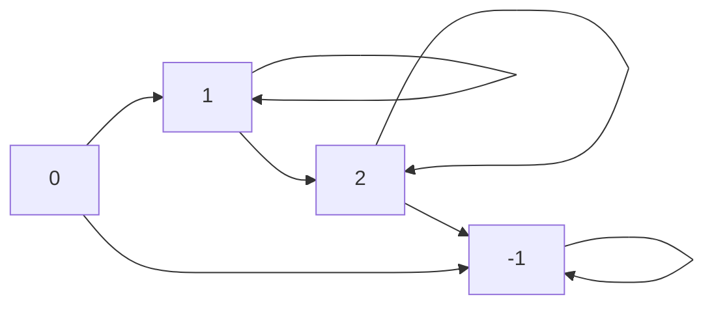

# Count the Number of Special Characters II

You are given a string word. A letter c is called special if it appears both in lowercase and uppercase in word, and every lowercase occurrence of c appears before the first uppercase occurrence of c.

Return the number of special letters in word.

Example 1:

Input: word = "aaAbcBC"

Output: 3

Explanation:

The special characters are 'a', 'b', and 'c'.

Example 2:

Input: word = "abc"

Output: 0

Explanation:

There are no special characters in word.

Example 3:

Input: word = "AbBCab"

Output: 0

Explanation:

There are no special characters in word.

Constraints:

    1 <= word.length <= 2 * 10^5
    word consists of only lowercase and uppercase English letters.

自己阅读理解出搓出来的：

```python
class Solution:
    def numberOfSpecialChars(self, word: str) -> int:
        d = defaultdict(list)
        for i, w in enumerate(word):
            d[w].append(i)
        res = 0

        for w in word:
            if w.upper() in d and w.lower() in d:
                if d[w.lower()][-1] < d[w.upper()][0]:
                    res += 1
                del d[w.upper()]
                del d[w.lower()]
        return res
```

方法一：状态机（一次遍历）

对于每种字母，定义如下四种状态：

    0：初始状态。如果遇到小写字母，转到状态 1，否则不合法，转到状态 −1。
    1：如果遇到小写字母则不变，遇到大写字母则转到状态 2。
    2：如果遇到大写字母则不变，遇到小写字母则转到状态 −1。
    −1：遇到任何字母都不再变化。



答案为状态为 2 的字母种数。注意题目要求同一种字母的大小写形式都得有。

附 ASCII 字符的性质：

    对于大写英文字母：二进制从右往左第 6 个比特一定是 0。
    对于小写英文字母：二进制从右往左第 6 个比特一定是 1。
    对于任何英文字母：小写字母的二进制低 5 位，等于其大写字母的二进制低 5 位。

```python
class Solution:
    def numberOfSpecialChars(self, word: str) -> int:
        ans = 0
        state = [0] * 27
        for c in map(ord, word):
            x = c & 31  # 转成数字 1~26
            if c & 32:  # 小写字母
                if state[x] == 0:
                    state[x] = 1
                elif state[x] == 2:  # 大写的后面不能有小写
                    state[x] = -1
                    ans -= 1
            else:  # 大写字母
                if state[x] == 0:  # 还没遇到小写，就先遇到大写了
                    state[x] = -1
                elif state[x] == 1:
                    state[x] = 2
                    ans += 1
        return ans
```

方法二：位运算（一次遍历）

把小写字母加到集合 lower 中，大写字母（转成小写后）加到集合 upper 中。

如果遍历到小写字母 c 时，发现 c 也在 upper 中，说明大写字母在小写字母的左边，那么把 c 加到集合 invalid 中。

最后计算 lower 和 upper 的交集，并从交集中去掉 invalid 中的元素，剩下的元素个数即为答案。

代码实现时，用二进制表示集合，用位运算实现集合操作

```python
class Solution:
    def numberOfSpecialChars(self, word: str) -> int:
        lower = upper = invalid = 0
        for c in map(ord, word):
            bit = 1 << (c & 31)
            if c & 32:  # 小写字母
                lower |= bit
                if upper & bit:  # c 也在 upper 中
                    invalid |= bit  # 不合法
            else:  # 大写字母
                upper |= bit
        # 从 lower 和 upper 的交集中去掉不合法的字母 invalid
        return (lower & upper & ~invalid).bit_count()
```

用 set 也可以实现，代码更简洁易懂：

```python
class Solution:
    def numberOfSpecialChars(self, word: str) -> int:
        lower = set()
        upper = set()
        invalid = set()
        for c in word:
            if c.islower():  # 小写字母
                lower.add(c)
                if c in upper:  # 大写的后面不能有小写
                    invalid.add(c)  # 不合法
            else:  # 大写字母
                upper.add(c.lower())
        # 从 lower 和 upper 的交集中去掉不合法的字母 invalid
        return len((lower & upper) - invalid)
```
